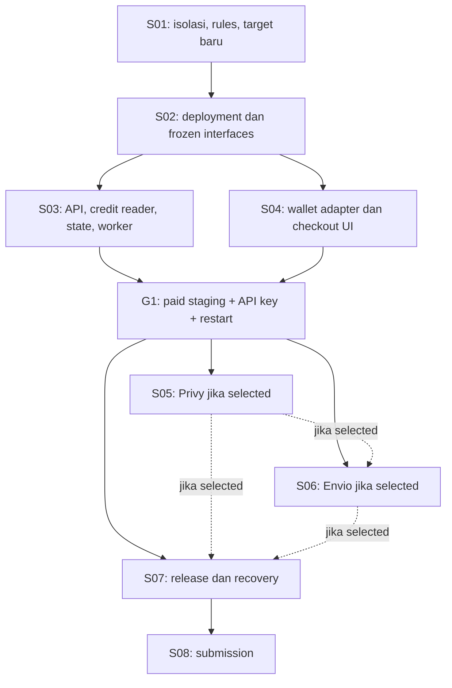

# Mapping kekurangan dan penambahan Archava Monad

Tanggal: 11 Oktober 2026. Baseline yang diperiksa: `fc39413a0e1bf72e875f9ee59df2bcfbf64ead94`, branch `monad`, clone lokal `../Archava-Monad/`. Dokumen ini melengkapi [blueprint revision4](archava-monad-metropolis.md); urutan S01–S08 dan selected sponsor provisional Privy + Envio tetap sama.

**Kesimpulan:** fondasi rental menit dan sesi avatar sudah ada dalam source. Pekerjaan utama adalah memisahkan target deployment, mengganti dependensi chain BNB, membenahi pembacaan kredit, menambahkan pilihan wallet, dan membuktikan alur Monad sebelum integrasi sponsor.

Status di bawah berdasarkan inspeksi source dan keberadaan file, bukan hasil runtime. Dependencies aplikasi belum di-install; build, tests, transaksi, paid voice dan restart deployment Monad belum diuji. Status clone/integritas Git tersedia di [evidence clone](archava-monad-clone.md). Tidak ada persentase kesiapan atau estimasi waktu baru yang dianggap terukur.

## 1. Fondasi yang dipakai ulang

| Bagian | Yang sudah ada | Tindakan untuk Monad |
| --- | --- | --- |
| Kontrak | [RentalV2](../Archava-Monad/packages/contracts/src/ArchavaRentalV2.sol) menerima ERC-20, paket 60/300 menit, expiry, pause dan event `AccessRented`; [MockUSDT](../Archava-Monad/packages/contracts/src/ArchavaMockUSDT.sol) memiliki decimals 6 dan faucet sekali per wallet. | Pakai logika yang sama, build/test lalu deploy instance baru. |
| Checkout | [rental.ts](../Archava-Monad/src/lib/rental.ts) memiliki connect wallet, faucet mUSDT, quote, exact-amount approve, rent dan pemeriksaan receipt. | Adapt provider/network dan status pembayaran. |
| Saldo dan sesi | [usage.mjs](../Archava-Monad/server/usage.mjs) menyimpan usage/reservation dengan penulisan atomik; [customer-sessions.mjs](../Archava-Monad/server/customer-sessions.mjs) menyatukan sesi website dan API key. | Pertahankan metering; tambahkan scope state dan pembuktian restart. |
| Auth dan API key | [auth.mjs](../Archava-Monad/server/auth.mjs), [developer-api.mjs](../Archava-Monad/server/developer-api.mjs) dan [apikeys.mjs](../Archava-Monad/server/apikeys.mjs) menyediakan challenge sekali pakai, purpose sesi/dashboard berbeda, keys digest, revoke dan usage. | Pertahankan; tambahkan chain/deployment pada challenge dan selected provider pada UI. |
| Avatar dan voice | [agent.py](../Archava-Monad/backend/agent.py), [LiveRoom.tsx](../Archava-Monad/src/components/LiveRoom.tsx) dan integrasi LiveKit/Gemini/Spatius sudah ada. | Project/credentials baru, startup guard, metadata scope dan facts Monad. |
| Packaging dan pemeriksaan | [Dockerfile](../Archava-Monad/Dockerfile), worker supervision, readiness, browser fixtures, app/Python/Solidity tests dan [CI](../Archava-Monad/.github/workflows/verify.yml) sudah tersedia. | Extend untuk isolation, kontrak, config/manifest dan paid staging; keberadaan suite belum berarti pass. |

Semantik produk tetap: menit dihitung sebagai waktu room yang dialokasikan, satu paid room per wallet lintas website/API, maksimum 30 menit per room, early close mengembalikan reservation yang belum terpakai. Expiry akses belum berarti expiry setiap grant menit: pembelian setelah expiry dapat membuat sisa menit historis tersedia kembali. Perubahan expiry per paket merupakan scope produk tersendiri.

## 2. Daftar gap yang harus dikerjakan

P0 = prasyarat isolasi sebelum menjalankan runtime/push/deploy. P1 = produk inti dan release yang harus terbukti. P2 = integrasi sponsor sesudah core staging lolos; hanya wajib jika sponsor tetap dipilih.

| ID / prioritas | Kondisi kode atau evidence sekarang | Yang diperbaiki / ditambahkan | Step dan bukti selesai |
| --- | --- | --- | --- |
| G01 / P0 — isolasi target | [.env.example](../Archava-Monad/.env.example) memakai chain97/address BNB; [vercel.json](../Archava-Monad/vercel.json) masih rewrite ke Railway lama. API [index.mjs](../Archava-Monad/server/index.mjs) langsung membuat dependencies/jobs; worker langsung register. Target guard/startup lock belum ada. | Sanitasi defaults/rewrite/broadcast aliases, record target nonsecret, guard remote/hosting/contracts, startup lock API dan Python worker sebelum clients/jobs. Default real runtime disabled hingga validasi S03 siap. | S01. Missing target atau inherited BNB env menolak operasi sebelum side effect; offline mock checks green. |
| G02 / P1 — konfigurasi publik | Chain/address/block diambil dari env/fallback; [dependencies.mjs](../Archava-Monad/server/dependencies.mjs) default chain97, [rental.mjs](../Archava-Monad/server/rental.mjs) menolak chain selain 97. `/api/config` belum punya metadata network/explorer/manifest yang dibutuhkan target baru. | `config/networks.json`, loader manifest, metadata API/browser tunggal, validasi actual chain/token/bytecode/quotes. Target blueprint 10143; actual endpoint wajib membuktikan chain tersebut. Env tambahan harus cocok manifest. | Interface dibekukan S02; consumer API S03/UI S04. Salah chain/address/block/token menolak konfigurasi; credentialed RPC tetap server-side. |
| G03 / P1 — deployment kontrak | Script deploy/verify, Foundry RPC alias dan manifest masih BSC; source Solidity RentalV2/MockUSDT sudah tersedia. | `deploy-monad-v2.ts`, `verify-monad-v2.ts`, alias Monad, deployment token + RentalV2 baru dan `monadTestnetV2.json` dengan ABI/address/block/owner/compiler metadata. | S02. Generic contract tests pass; actual receipt, verified source dan owner/token/package read-back sesuai manifest. |
| G04 / P1 — pembacaan kredit | [rental.mjs](../Archava-Monad/server/rental.mjs) memanggil `getLogs` dari deployment block hingga latest pada setiap request, dengan page tetap 5.000 blok. Tidak ada persisted purchase cursor/cache. | Scanner direct RPC incremental, finalized-only, cursor/totals atomik, dedup events, block-hash checkpoints, provider-compatible ranges, bounded retry/backoff dan status sync unavailable/pending. | S03. Restart/reorg/corruption/429/aged-gap tests; warm access p95 ≤2 detik dan finalized receipt→balance ≤10 detik sebagai target aplikasi yang harus diukur. |
| G05 / P1 — state deployment | `ARCHAVA_STATE_DIR`, `keys.json` dan ledger version2 sudah ada. State belum terikat chain+rental+token; API membaca state saat dibutuhkan, bukan memvalidasi semuanya sebelum jobs. | Scope/version validation untuk keys, usage, reservation dan cursor sebelum runtime dibuka. Mulai state Monad kosong; pertahankan penulisan atomik dan satu writer. | S03. Wrong-scope/corrupt state ditolak; paid usage/reservations/keys/cursor bertahan restart tanpa menit gratis atau dobel. |
| G06 / P1 — signature scope | Challenge sudah memiliki wallet, origin, purpose, nonce dan issued time; verification memakai EOA `verifyMessage`. Belum ada chain/deployment dalam message. | Scope chain+deployment pada challenge sesi dan dashboard; tetap nonce sekali pakai dan purpose terpisah. EOA adalah scope MVP; verifier smart account tidak diasumsikan tersedia. | S03. Wrong purpose/chain/deployment/nonce/EOA owner ditolak; signature benar membuka jalur yang sesuai. |
| G07 / P1 — pilihan provider wallet | [rental.ts](../Archava-Monad/src/lib/rental.ts) dan [developer.ts](../Archava-Monad/src/lib/developer.ts) mengambil `window.ethereum`; [App.tsx](../Archava-Monad/src/App.tsx) menangani accountsChanged, tetapi belum memakai adapter selected provider atau lifecycle chain/provider yang sama. | `src/lib/wallet.ts` dengan EIP-1193 provider terpilih untuk faucet/approve/rent/sign/dashboard. Cancel hasil async lama dan logout dashboard saat account/provider/chain berubah. | S04. External adapter bekerja lebih dulu; tests wallet A→B, chain change, logout dan provider switch tidak menulis saldo/session wallet lama. |
| G08 / P1 — UX checkout Monad | UI/explorer/add-chain masih BNB; flow memeriksa saldo mUSDT tetapi belum menyediakan alur gas MON dan status receipt provisional→entitlement finalized. | Metadata network/explorer dari config, funding/faucet instructions, cek gas/token, status approval/rent/pending/synced/rejected, retry yang tidak membeli ulang. | S04 + G1. Fresh wallet bisa memperoleh MON/mUSDT, membeli, menunggu saldo dan membuka Ava; receipt pending tidak memberi paid access. |
| G09 / P1 — worker dan pengetahuan Ava | Room/sweeper hanya memakai `product: archava`; nama worker default lama. [knowledge.py](../Archava-Monad/backend/knowledge.py), `site_context.py` dan instructions masih menyebut BNB; release flags default off. | Dedicated LiveKit project/credentials, deploymentId pada room metadata dan scope checks yang sama di API/worker. Update UI copy, facts dan runbook ke Monad sesuai fitur yang telah dibuktikan. | Isolation S01/S03; availability facts final S07. Wrong project/scope ditolak; Ava menjelaskan demo mUSDT dan status fitur sesuai evidence. |
| G10 / P0 — akun dan layanan baru | Clone lokal sudah ada, remote kosong. Repo GitHub/target IDs/domain/project/credentials Monad belum diprovision atau terverifikasi dalam pekerjaan ini. | Repo Monad; Vercel project/domain; Railway project+environment+service+volume; LiveKit project; RPC endpoint, voice credentials dan deployer khusus. Privy app/Envio indexer sesuai selected sponsor. | S01 inventory/provisioning; target lengkap sebelum operasi terkait, G1 membuktikan staging, S07 membuktikan release. Tidak memakai linkage/state BNB. |
| G11 / P1 — build dan CI | CI existing menjalankan app/Python/browser/build/Docker; belum checkout recursive submodule atau menguji package kontrak dengan pinned Foundry. Docker belum COPY config/manifest Monad. | Adapt offline fixtures, isolation suites, contract checks, artifact packaging dan image smoke. Test transisi hanya exact allowlist dengan owner/removal step; generic/isolation/build tetap wajib green. | S01–S04 + S07. S01 mandatory checks pass; allowlist habis sebelum G1; image membaca path config/manifest produksi yang disepakati. |
| G12 / P1 — staging paid flow | Source memiliki alur berbayar; belum ada transaksi atau call dari deployment Monad yang diuji. Health/readiness belum membuktikan microphone/avatar/paid entitlement. | G1: external-wallet purchase→finalized credits→signed voice room→early close, API key→`POST /v1/sessions`, revoke dan restart pada service/volume baru. | Sesudah S03 + S04, sebelum sponsor. Receipt, real voice/avatar, balance settlement dan restart retention tercatat sebagai evidence terpisah dari mocks. |
| G13 / P2 — Privy | Tidak ada dependency/provider/login Privy di source. | Privy React SDK yang dipin, app/origin/default/supported chain config, login→embedded EOA, selected provider yang sama untuk payment dan signature; external wallet tetap tersedia. | S05 setelah G1 dan eligibility cocok. Clean browser login→MON/mUSDT→approve/rent→paid session→dashboard berhasil. Login sendiri tidak memberi gas atau entitlement. |
| G14 / P2 — Envio/history | `packages/indexer`, purchase route dan UI riwayat pembelian belum ada. Usage/session history existing berbeda dengan event pembelian onchain. | Index `AccessRented`, schema/handler/tests, deployment indexer, read-only `GET /api/purchases?wallet=...`, bounded pagination, tx links dan status sync/unavailable. | S06 setelah G1/S04 dan S05 jika Privy selected. Satu receipt muncul tepat sekali; filter exact chain+contract; indexer gagal tidak mengubah authoritative balance/paid access. |
| G15 / P1 — release dan recovery | Template hosting/readiness sudah ada; prosedur maintenance/drain/stop-before-start/rollback untuk target Monad belum dibuktikan. | Runbook satu writer termasuk saat rollout, consistent backup, compatible schema/image, guarded release, GET-only preflight Monad dan live smoke. | S07. Tidak ada overlap writer, lost/doubled usage atau pemulihan saldo dari backup lama; URL publik sesuai target baru. |
| G16 / P1 — aturan dan submission | Track02/Privy/Envio masih pilihan provisional. Authenticated rules, effective deadline dan final evidence submission belum dikonfirmasi. | `docs/monad/eligibility.md`, README existing-vs-new delta, tx/demo/code links, demo video, sponsor evidence bila memenuhi rules, final portal receipt. | Rules S01; submission S08. Track/network/evidence cocok rules akun; selected sponsor hanya yang benar-benar selesai. |

Untuk G04/G08, dokumentasi Monad menyarankan `finalized` untuk payment crediting dan menjelaskan batas `eth_getLogs` berbeda menurut provider. Angka 5.000 dari BNB tidak menjadi asumsi limit endpoint Testnet baru; endpoint yang dipilih harus diuji. [Monad JSON-RPC](https://docs.monad.xyz/reference/json-rpc/overview).

G13 mengikuti explicit network configuration Privy; G14 memakai HyperIndex sebagai sumber riwayat event. Pemisahan riwayat Envio dari entitlement direct RPC adalah keputusan arsitektur Archava. [Privy network configuration](https://docs.privy.io/basics/react/advanced/configuring-evm-networks), [Envio HyperIndex](https://docs.envio.dev/docs/HyperIndex/overview).

## 3. Input yang perlu disiapkan

| Input | Status pekerjaan ini | Dipakai ketika |
| --- | --- | --- |
| Rules akun event, accepted network, effective deadline dan bounty fields | Belum dikonfirmasi lewat portal login. Jadwal lama blueprint bukan hasil verifikasi baru. | S01 sebelum memilih eligibility final; S08 submission. |
| GitHub repo tujuan + hosting/LiveKit/RPC target IDs dan URLs baru | Belum diverifikasi/provision; jangan isi placeholder sebagai target valid. | S01; actual mode guard harus lengkap sebelum push/deploy/runtime terkait. |
| Deployer dan gas MON, token demo dan package settings | Instance Monad belum dideploy. Funding dan provider access belum diuji. | S02 deployment; G1 checkout. |
| Privy app/origins + login method pilihan operator | Belum diintegrasikan/terverifikasi. | S05 jika selected sponsor tetap cocok. |
| Envio account/token/endpoint Testnet dan version yang dipin | Belum diintegrasikan/terverifikasi. | S06 jika selected sponsor tetap cocok. |
| Kebijakan preview untuk demo | Source mendukung preview opsional, default off, tanpa usage quota ketika enabled. | Putuskan enable/off sebelum staging/release; paid G1 tetap wajib. |
| Dependensi lokal dan history | `node_modules`/`.venv` belum tersedia; Git baseline exact tetapi shallow. | Setup test environment sebelum implementasi/checks; lengkapi history ketika akses upstream memungkinkan. |

Credentials dan wallet private key disiapkan di channel/storage privat, tidak masuk gap map atau evidence publik. Tidak ada inspeksi private env atau claim voucher dalam mapping ini.

## 4. Urutan kerja yang disarankan

S03/S04 memakai frozen interfaces dari S02. Untuk satu builder, dikerjakan berurutan; dependency diagram tidak mengizinkan concurrent edits tanpa ownership. Jika sponsor di-de-scope, update selected set, DAG/tests/rollback dan indeks sesuai blueprint; `skipped` tidak menjadi `done`.

Hasil yang perlu dibuktikan sebelum memperluas fitur: **wallet baru → MON untuk gas → faucet demo mUSDT → approve/rent di Monad → saldo API finalized → paid Ava voice/avatar → end call → saldo benar → API key session → restart tetap konsisten**.

## 5. Penambahan yang ditunda

Tidak masuk sprint yang disepakati: rewrite framework/Next.js/PWA, multi-chain picker, token payment bernilai nyata, smart account/paymaster/passkey, x402/trading/agent payments, LLM provider tambahan, multi-tenant avatar builder dan migrasi database multi-replica. Fondasi UI/API/ledger/voice tetap dipakai ulang; tambahan produk ini memiliki scope/test/biaya tersendiri.

## 6. Checklist mapping

- [x] Baseline source, runtime entrypoints dan file konfigurasi diperiksa.
- [x] Fondasi reuse dibedakan dari fitur baru dan integration gaps.
- [x] Gap diberi prioritas, ownership step dan bukti selesai; dependencies sponsor tetap conditional.
- [x] Dokumen primer RPC/Privy/Envio dibaca untuk batas integrasi, tanpa menganggap eligibility event telah terkonfirmasi.
- [x] Review adversarial mapping diselesaikan; tidak ada temuan critical/high/medium.
- [ ] Implementasi S01–S08 dan runtime exit criteria; semuanya masih mengikuti status di indeks.

Cursor setelah mapping: lanjutkan S01 ketika implementasi diminta. Tindakan sesi mapping hanya membaca source/dokumentasi dan memperbarui dokumen; tidak menjalankan API/worker, transaksi, install atau deployment.

Review read-only pada 11 Oktober 2026 menerima dokumen ini sebagai **mapping**, setelah memeriksa source pinned, reuse/metering/expiry, gap scanner/wallet/worker/CI/Docker, prioritas, dependencies conditional sponsor dan tautan lokal. Verdict tersebut tidak menyatakan build/tests/paid runtime/layanan eksternal sudah pass. Catatan review ada di [laporan review](archava-monad-review.md).
