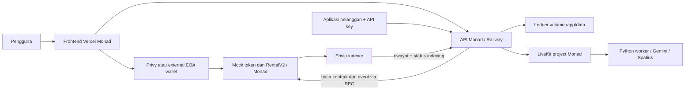
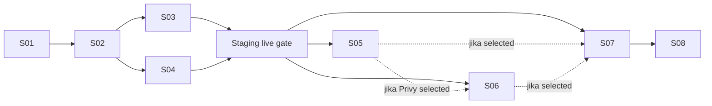

# Blueprint Archava untuk Monad Metropolis

Revisi: **4 — final, accepted as plan setelah review adversarial isolasi repo/runtime dan resources**. Dibuat 11 Oktober 2026, WIB. Status pekerjaan: **blueprint dan persiapan clone lokal; migrasi, transaksi, pembuatan repo GitHub/layanan dan deployment belum dijalankan**. Dokumen aktif berada di `/home/pupulion/Archava-Monad-Blueprint/plans/`, di luar checkout BNB.

Instruksi user terbaru untuk sesi coding: user menyiapkan repo GitHub sendiri. Agent memakai monskill dan mengimplementasikan kode di repo yang diberikan; pembuatan repo, pengaturan remote, push dan PR bukan scope prompt. Instruksi ini menggantikan bagian setup GitHub/workflow publikasi di bawah untuk sesi tersebut. Lihat [prompt implementasi S01](archava-monad-s01-prompt.md).

Update persiapan source, 11 Oktober 2026: atas permintaan user, clone lokal independen sudah disiapkan di `/home/pupulion/Archava-Monad-Blueprint/Archava-Monad`, lokasi yang dapat ditulis dalam sesi ini. Commit dan tree cocok persis dengan pinned baseline `fc39413a`; branch `monad`, remote kosong, submodule `forge-std` independen dan history pinned masih shallow. Repo GitHub/layanan belum dibuat. Ini baru persiapan clone S01; sanitasi dan startup lock belum diimplementasikan, sehingga belum menjadi runtime Monad. Lihat [evidence clone](archava-monad-clone.md). Path sibling `/home/pupulion/Archava-Monad` pada rencana berikut tetap target runtime yang diusulkan.

[Mapping kekurangan](archava-monad-gap-map.md) menghubungkan source clone dengan kebutuhan S01–S08: fondasi reuse, gap, input, prioritas dan bukti selesai. Mapping tidak mengubah selected sponsor/urutan step dan tidak menyatakan runtime sudah diverifikasi.

## 1. Keputusan yang bisa langsung dipakai

**Pakai ulang kode Archava dan `ArchavaRentalV2`, tetapi bangun versi hackathon di folder dan repo GitHub independen.** Target folder runtime `/home/pupulion/Archava-Monad`; usulan repo baru `Archzxylabs/Archava-Monad`, branch integrasi/default `monad`. Gunakan Vercel project baru, **Railway project/environment/service/volume baru**, **LiveKit project baru**, serta credentials dan deployer wallet khusus Monad. Ini menggantikan keputusan repo bersama pada revisi sebelumnya.

Produk yang dibangun: **Archava — akses AI avatar untuk website dan aplikasi, dibayar dengan paket menit di Monad**. Alur unggulan: login → wallet → test token → beli paket → mulai Ava → lihat sisa menit dan riwayat pembelian → pakai API key dari aplikasi lain.

Track utama: **02 — Consumer Products & Payments**. Bounty yang ditargetkan: **Privy + Envio**, setelah persyaratan portal dikonfirmasi. Resources eksekusi cukup **Monad docs + Privy React embedded EOA + Envio HyperIndex + satu RPC provider**. Envio Docs MCP hanya alat opsional saat mengerjakan indexer. Semua sponsor lain ada di [matriks referensi](archava-monad-sponsors.md); daftar itu bukan daftar integrasi.

Track 04 cocok jika nanti produk benar-benar membangun identitas, provenance, atau trust untuk agent. Kehadiran avatar AI sendiri belum membuat arah itu lebih tepat daripada pembayaran produk konsumen. Ini rekomendasi berdasarkan produk, bukan keputusan kelayakan dari penyelenggara. [Tracks resmi](https://hackathon.monad.xyz/tracks).

**Kontrak perlu dibangun ulang menjadi artifact dan di-deploy ulang; logika Solidity tidak perlu ditulis ulang dari nol.** BNB dan Monad sama-sama menggunakan EVM, tetapi instance kontrak, saldo, akses, receipt, dan ledger setiap chain berbeda. [Monad developer essentials](https://docs.monad.xyz/developer-essentials/summary).

## 2. Deadline, eligibility, dan batas scope

Portal publik menampilkan deadline **14 Oktober 2026 pukul 03:59 UTC = 10:59 WIB**, sejalan dengan akhir 13 Oktober di waktu AS. Target internal: **submit final pada 13 Oktober pukul 20:00 WIB**. Saat mulai eksekusi, cek ulang waktu efektif di akun portal karena metadata publik belum membuktikan tidak ada perubahan deadline per akun. [Portal Metropolis](https://hackathon.monad.xyz/tracks).

FAQ resmi memperbolehkan proyek existing dengan pekerjaan baru dalam build window 1 September–13 Oktober. README harus menjelaskan apa yang sudah ada di BNB dan apa yang baru untuk Monad. Jangan menyebut seluruh Archava sebagai karya yang baru dibuat untuk event ini. Submit satu primary track; portal memungkinkan beberapa bounty, dengan field khusus masing-masing. [FAQ dan sponsor resmi](https://www.monad.xyz/developers/hackathons/metropolis), [pilihan track dan bounty](https://hackathon.monad.xyz/tracks).

Detail eligibility, pembatasan track bounty, network yang diterima, format video, dan field submission perlu dibaca setelah login. Endpoint katalog lengkap memerlukan autentikasi; blueprint ini tidak menganggap semua bounty otomatis menerima Track 02 atau deployment testnet. **S01 memutuskan ini sebelum integrasi sponsor.** Bila aturan mewajibkan mainnet atau penggunaan token bernilai nyata, evaluasi scope dan biaya secara eksplisit; jangan menggantinya diam-diam dengan demo mUSDT.

| Prioritas | Hasil |
| --- | --- |
| Wajib produk | Monad RentalV2 + mock token, checkout, signed access, sesi Ava, API key, saldo menit, deployment terpisah, demo nyata |
| Target bounty | Wallet Privy yang benar-benar dipakai untuk transaksi dan tanda tangan; Envio untuk riwayat pembelian yang terlihat di UI |
| Resource minimum | Satu endpoint RPC yang lolos chain/finality/log-budget check; pilih provider yang akun dan akses testnet-nya siap |
| Setelah event | Token pembayaran produksi, cross-chain payment, x402, smart account/passkey, agent reputation, multi-tenant avatar builder, database untuk banyak replica |

Jika waktu habis, rilis produk inti dan submit track utama. Bounty hanya dicentang jika integrasi selesai dan persyaratan terpenuhi. De-scope bounty yang belum berfungsi sambil mempertahankan bukti live checkout dan voice call. Tambahan LLM, trading, x402 dan MCP lain tidak masuk sprint ini.

## 3. Baseline yang sudah diperiksa

Repo yang dimaksud adalah [`Archzxylabs/Archava`](https://github.com/Archzxylabs/Archava), checkout `/home/pupulion/Archava`; bukan `/home/pupulion/Archava-Platform`.

| Item | Temuan pada 11 Oktober |
| --- | --- |
| Checkout lokal | Branch `feat/mock-usdt-rental-v2-integration`, HEAD `297aa1bef07752f494fa8a522d94c399e6d93446`; awalnya bersih |
| GitHub main | `fc39413a0e1bf72e875f9ee59df2bcfbf64ead94`, 3 Oktober; delapan commit di depan checkout lokal dan mencakup RentalV2 |
| Tracking lokal | `origin/main` lokal masih `051bc8f`; belum di-fetch dalam pekerjaan blueprint ini |
| Deployment BNB | README main menyebut Vercel project `archava-onchain`, domain sekarang `archava.vercel.app`; domain lama redirect 308 |
| Backend main | Railway; Docker menjalankan Node API + Python voice worker dengan supervisi; satu replica dan readiness worker |
| Persistent storage | Main sudah mendukung `ARCHAVA_STATE_DIR`; Docker mengatur `/app/data`. Volume nyata tetap harus dipasang di service baru |
| Verifikasi main | `verify:local`, browser fixtures, artifact checks, public read-only preflight, GitHub Actions, Docker build |
| Tool lokal | Git dan gh tersedia; gh auth terverifikasi; Node 24.20, Forge 1.8.1, uv tersedia; `.venv` lokal belum ada |

Sumber baseline: [main yang diperiksa](https://github.com/Archzxylabs/Archava/tree/fc39413a0e1bf72e875f9ee59df2bcfbf64ead94), [diff delapan commit](https://github.com/Archzxylabs/Archava/compare/297aa1bef07752f494fa8a522d94c399e6d93446...fc39413a0e1bf72e875f9ee59df2bcfbf64ead94), [panduan deployment existing](https://github.com/Archzxylabs/Archava/blob/fc39413a0e1bf72e875f9ee59df2bcfbf64ead94/docs/deployment/DEPLOYMENT.md).

Code inspection menemukan hardcode BNB di deploy script, API rental reader, frontend chain fallback/explorer, public preflight, dan konfigurasi. Frontend memakai `window.ethereum`; integrasi Privy butuh provider yang dipilih untuk semua transaksi dan signature. Sweeper LiveKit menghapus room yang metadata-nya `product: archava`; ganti nama worker saja belum memisahkan demo.

Pengecekan GET ke host legacy menghasilkan health `ok` dan config chain 97 setelah mengikuti redirect. Itu **bukan** bukti transaksi berbayar atau voice call baru sukses. Blueprint tidak menjalankan suite runtime atau paid smoke test. Main remote dibaca melalui file publik yang dipin ke commit di atas; tidak di-checkout di direktori lama.

## 4. Repo, direktori, dan hosting

| Komponen | Versi BNB existing | Versi Monad |
| --- | --- | --- |
| Folder lokal | `/home/pupulion/Archava` | `/home/pupulion/Archava-Monad`, clone independen dengan `.git` sendiri |
| Repo/remote | `Archzxylabs/Archava` | Repo baru, usulan `Archzxylabs/Archava-Monad`; origin hanya repo Monad |
| Branch rilis | `main` existing | Default/integrasi `monad` di repo baru |
| Branch per langkah | Existing branch tidak diubah | `monad/s01-*` sampai `monad/s08-*`; PR hanya ke `monad` repo baru |
| Vercel | `archava-onchain` / `archava.vercel.app` | Project dan domain baru, misalnya `archava-monad`; Git source repo Monad |
| Railway | Project/service existing | Project + environment + service `archava-monad-backend` + volume baru `/app/data`; satu replica |
| LiveKit | Project existing | Project baru + credentials baru; worker `archava-monad-host` |
| State | Ledger dan keys BNB | Ledger dan keys kosong khusus deployment Monad |
| Kontrak | Deployment chain 97 | Deployment baru chain 10143, manifest sendiri |
| Privy / Envio | Tidak diasumsikan ada | App Privy dan indexer baru; origin serta chain khusus Monad |
| RPC / voice credentials | Credentials production existing | Endpoint/key/app khusus Monad; Gemini/Spatius credentials terpisah jika provider mendukung |
| Deployer | Wallet/credentials BNB existing | Wallet baru khusus hackathon, didanai test MON; owner instance Monad |

Nama repo/project/domain baru adalah usulan, belum dibuat atau dijamin tersedia. Clone HTTPS independen boleh membawa source dan history sebagai bukti existing work; tidak boleh memakai `git worktree`, `--shared`, `--reference`, atau copy `.git` dari folder BNB. Remote BNB yang otomatis dibuat clone harus dilepas sebelum pekerjaan berikutnya. Jangan copy `.env`, `.vercel`, Railway linkage, `data/`, `node_modules`, `.venv`, wallet keystore atau session token dari folder lama. Dokumen aktif ini boleh disalin ke `plans/` repo Monad saat S01.

**Repo/folder baru belum cukup jika config bawaan masih BNB.** S01 harus menghapus rewrite API ke `archava-backend-production.up.railway.app`, default origin `archava.vercel.app`, chain/address BNB pada active env template, dan alias broadcast/verify BSC pada entrypoint aktif. Jika URL Monad belum ada, fitur API/paid harus disabled/fail-closed; jangan fallback ke BNB. Source/history BNB boleh tetap ada sebagai referensi, bukan target runtime atau deploy yang bisa terpilih otomatis.

Tambahkan guard lokal `scripts/verify-deployment-target.mjs` pada S01. Record nonsecret `config/deployment-targets.monad.json` berisi expected remote repo Monad, chain `10143`, public origins, Vercel project ID serta Railway project/environment/service ID baru; LiveKit URL/project scope ditulis tanpa secret. Identifier yang belum diketahui tetap kosong dan **memblokir mode deploy**, bukan placeholder yang lolos. Guard berjalan sebelum wrapper push/deploy/contract broadcast dan membandingkan actual target dengan record. Git hanya boleh push origin repo Monad; Vercel `.vercel/project.json` harus project baru; Railway target harus diperiksa lewat CLI versi terpasang/read-only project status dan context eksplisit, bukan last-linked project. Tidak mengarang CLI flags; pilih dashboard Git integration atau wrapper dengan target eksplisit setelah membaca docs versi yang dipakai. Guard lokal membantu workflow ini, bukan jaminan terhadap perintah manual yang melewatinya.

**Startup juga wajib guarded.** Baseline API membaca `process.env` dan membuat LiveKit client/sweeper; worker juga menerima shell env. S01 harus memasang startup lock pada entry API/worker **sebelum membuat provider client, sweeper, background job atau worker registration**. Default runtime disabled; flag enable saja tidak cukup tanpa deployment ID, expected chain/RPC target, dedicated LiveKit URL/project, origin dan state-path/scope yang cocok. Sampai validasi runtime S03 tersedia, real API/worker tetap terkunci; offline tests memakai explicit mocked providers dan env allowlist yang tidak mewarisi shell credentials. Ini tidak menghalangi deploy kontrak S02 melalui guard contracts yang terpisah. Di S03 setiap startup API/worker memvalidasi target record bersama actual Monad RPC/manifest dan dedicated LiveKit URL/scope; API memvalidasi ledger/cursor sebelum jobs. Inherited BNB RPC URL/chain, LiveKit URL atau state path harus reject sebelum query/room side effect. Python worker menjalankan pemeriksaan yang sama pada entry-nya, bukan hanya percaya flag dari parent launcher. Dedicated key yang salah terhadap URL baru harus auth-fail, tanpa fallback ke project BNB.

Git integrations Vercel/Railway baru harus memilih **repo Monad dan branch `monad`**. Tidak membuat PR ke repo BNB atau menyambungkan project existing ke repo baru. CI repo baru tidak memakai deploy secrets BNB; backend auto-deploy nonaktif sampai prosedur satu-writer S07 terbukti. Frontend preview dan production sama-sama harus menunjuk backend Monad. [Git clone resmi](https://git-scm.com/docs/git-clone), [Vercel Git](https://vercel.com/docs/git), [Railway CLI](https://docs.railway.com/cli).

Rencana struktur hasil akhir:

```text
Archava-Monad/
  plans/                         # blueprint, sponsor, review, indeks
  config/networks.json            # metadata publik chain; baru
  config/deployment-targets.monad.json # repo/hosting IDs nonsecret; guard target
  scripts/verify-deployment-target.mjs # guard sebelum operasi keluar
  server/runtime-target.mjs      # startup guard sebelum provider/sweeper
  backend/runtime_target.py      # worker startup guard dengan scope yang sama
  src/lib/wallet.ts               # provider adapter; baru
  src/lib/rental.ts               # menerima selected provider
  src/lib/developer.ts            # signature dari provider yang sama
  server/                        # API, entitlement, ledger existing
  backend/                       # Gemini + LiveKit + Spatius existing
  packages/contracts/
    src/ArchavaRentalV2.sol       # dipakai ulang
    src/ArchavaMockUSDT.sol       # mock baru di Monad
    scripts/deploy-monad-v2.ts    # baru
    scripts/verify-monad-v2.ts    # baru
    deployments/monadTestnetV2.json
  packages/indexer/               # Envio terisolasi, lockfile sendiri
  docs/monad/                     # runbook, delta karya baru, evidence
```

## 5. Arsitektur dan aturan data



**Checkout.** Pilih wallet → cocokkan network → cek MON untuk gas → faucet mock token bila perlu → `quoteRent` → approve amount tepat → `rent` → tunggu receipt sukses → API membaca entitlement → sign challenge → reserve waktu → buka Ava. Faucet, approval, dan rent memerlukan gas MON. Login Privy tidak otomatis memberi gas, saldo token, akses berbayar, atau API key.

**Sumber kebenaran.** RentalV2 mencatat pembayaran dan expiry. API membaca kontrak/event dari chain yang dikonfigurasi, lalu menghitung saldo dari purchased seconds dikurangi used dan reserved seconds. Envio hanya menyediakan tampilan riwayat; lag/error indexer tidak boleh mengubah entitlement atau mengizinkan room. API key menunjuk wallet di server, bukan wallet bebas dari request pelanggan.

**RPC credit reader wajib bounded.** Jangan membawa scan seluruh histori per request dan page 5.000 blok dari BNB. Gunakan satu incremental scanner direct RPC untuk deployment ini: cursor dan total grants per wallet tersimpan atomically dalam `purchase-cache.json` pada state scope yang sama, event dedup berdasarkan chain/contract/tx/log index. Scan numerik hanya sampai finalized head, dengan configured page size dari batas provider aktual dan adaptive split untuk range/result-limit errors. Cursor maju hanya setelah seluruh page sukses; retry/429/backoff punya batas waktu. Startup/backfill memakai job beranggaran request, bukan loop tak terbatas dalam HTTP request. Cache belum synced/fresh memberi status recoverable `payment_pending`/`credit_sync_unavailable`, bukan saldo palsu atau room gratis. Setelah synced, request saldo membaca cache tervalidasi plus active-access dari RPC current finalized view; tetap kurangi usage/reservation durable.

Checkpoint menyimpan block hash; mismatch, scope salah, data rusak atau head mundur menyebabkan invalidasi/rebuild fail-closed. Data unfinalized tidak dijadikan grant; wallet UI boleh menunjukkan receipt provisional lalu menunggu entitlement finalized. Target aplikasi yang harus dibuktikan: warm `/api/access` p95 ≤2 detik, dan finalized receipt→balance ≤10 detik pada provider demo, atau tampilkan pending/retry jujur sambil memperbaiki budget sebelum release. Angka ini acceptance target Archava, bukan jaminan network. [Finality, tags dan limit RPC resmi](https://docs.monad.xyz/reference/json-rpc/overview). Uji deployment berumur hingga akhir judging 27 Oktober dengan simulated gaps/provider limits, agar demo tidak hanya bekerja saat kontrak baru dibuat.

**Semantik yang dipertahankan.** Paket ID 1 = 60 menit, ID 2 = 300 menit; harga awal 4.9375 dan 18.6875 **demo mUSDT**, decimals 6; validity awal 30 hari. `rent` memperpanjang expiry wallet. Metering dihitung dari durasi room yang dialokasikan, bukan detik pengguna berbicara, dan bukan streaming payment onchain. Satu room berbayar aktif per wallet, maksimum 30 menit per room, close lebih awal mengembalikan reservation yang belum terpakai.

Reader existing menjumlah lifetime `AccessRented` ketika `hasActiveAccess` true. Akibatnya, setelah expiry, pembelian baru dapat membuat menit historis yang belum terpakai tersedia lagi. Pertahankan dan dokumentasikan semantik ini saat porting; jika ingin expiry terpisah per paket, itu perubahan produk/ledger/kontrak tersendiri. Jangan membuat klaim semua menit hangus persis 30 hari.

**Konfigurasi tunggal.** `config/networks.json` aktif hanya mengizinkan Monad Testnet `10143`; tidak ada network picker/fallback BNB. Deployment manifest menyimpan chain ID, address, ABI, deploy block/tx, owner, compiler settings dan package metadata. Server memuat deployment Monad dan memverifikasi network RPC, bytecode, `paymentToken`, decimals, dan package quote. Jika env address/chain/block juga diisi, harus cocok dengan manifest, bukan override diam-diam. `/api/config` mengeluarkan metadata publik yang diperlukan browser; credentialed RPC tidak ikut dikirim. Browser memakai API metadata; Privy network object dibuat dari public network JSON yang sama saat build. Jangan punya empat hardcode Monad berbeda di UI, reader, deployer, dan preflight.

Path image yang disepakati: `/app/config/networks.json` dan `/app/packages/contracts/deployments/monadTestnetV2.json`. S03 memiliki perubahan Dockerfile untuk COPY metadata publik ke frontend stage bila diimport dan ke runtime stage; `.dockerignore` harus mengizinkan file tersebut sambil tetap mengecualikan private env/data. S07 membuktikan built image bisa membaca path production ini, bukan hanya bahwa `docker build` pass.

**Isolasi state.** Tetap gunakan env existing `ARCHAVA_STATE_DIR`, bukan membuat nama `DATA_DIR` baru. Tambahkan metadata scope `chainId:rentalAddress:tokenAddress` pada state directory; tolak state yang scope-nya salah. Ledger BNB tidak diimpor ke Monad. API restart boleh menghilangkan login/nonce/preview ticket yang in-memory, tetapi keys digest, usage dan paid reservation harus tetap ada. Format baru perlu versioning dan runbook rollback; satu API writer saja.

**Wallet dan auth.** Wallet adapter menyediakan provider EIP-1193 terpilih, account, chain, transaksi dan `signMessage`. Ethers `BrowserProvider` memakai adapter tersebut, termasuk dashboard API key. Perubahan account/provider/chain membatalkan operasi UI lama dan logout dashboard; hasil async dari wallet lama tidak boleh menulis state baru. Challenge sekali pakai tetap membedakan purpose sesi dan dashboard, serta menambahkan chain dan deployment pada signed message. Scope MVP: EOA. EIP-1271/6492 dan smart account perlu verifier tersendiri, jadi tidak diasumsikan didukung oleh `verifyMessage` existing.

**LiveKit.** Kedua deployment memakai project berbeda karena sweeper legacy masih menerima semua metadata `product: archava`. Monad juga dapat menambah `deploymentId` pada metadata untuk konsistensi internal, tetapi itu tidak menggantikan pemisahan project. API dan worker Monad memakai project/agent name yang sama satu sama lain.

## 6. Network dan environment

| Parameter | Nilai / aturan |
| --- | --- |
| Network | Monad Testnet |
| Chain ID | `10143` (hex `0x279f`) |
| Gas | MON |
| RPC publik browser | `https://testnet-rpc.monad.xyz` |
| RPC server/deployer | Endpoint Monad yang divalidasi; private URL tetap server-side |
| Explorer | `https://testnet.monadscan.com` |
| Rental/token/deploy block | Diisi dari receipt nyata S02, bukan address BNB atau placeholder yang lolos startup |
| Compiler | Solidity 0.8.28 existing; pin settings dan cek kompatibilitas Monad saat build/deploy |

[Network resmi Monad](https://docs.monad.xyz/developer-essentials/testnet). Monad merekomendasikan Foundry 1.8+ dan viem 2.40+; periksa versi **resolved** lockfile, bukan hanya range `^2.23.0` existing. Pertahankan generic Solidity regression tests dan tambahkan `forge test --root packages/contracts --network monad -vv` ke CI/S02 supaya gas/execution Monad benar-benar dipilih. Entry point broadcast BSC dinonaktifkan di repo Monad; chain97 tetap fixture negatif. Test lokal tetap dilengkapi actual testnet deployment. [Tooling resmi](https://docs.monad.xyz/developer-essentials/summary), [Foundry network selection](https://docs.monad.xyz/tooling-and-infra/toolkits/foundry).

Env runtime yang digunakan: `CHAIN_ID`, `RPC_URL`, `RENTAL_CONTRACT`, `PAYMENT_TOKEN_CONTRACT`, `RENTAL_DEPLOYMENT_BLOCK`, `WEB_ORIGIN`, `ARCHAVA_STATE_DIR`, `ARCHAVA_WORKER_HEALTH_URL`, `ARCHAVA_AGENT_NAME`, dan **credentials baru** LiveKit/Gemini/Spatius. Nama variabel/provider existing boleh dipakai ulang; nilai secret BNB tidak dibawa. Env deployer: `MONAD_TESTNET_RPC_URL`, `MONAD_DEPLOYER_PRIVATE_KEY`. Privy app ID public boleh di `VITE_PRIVY_APP_ID`; app secret tidak. Envio endpoint/token tetap backend. Template aktif baru `.env.monad.example` tidak berisi secret atau address sebelum receipt nyata; hapus default BNB pada `.env.example` yang diwarisi agar tidak menjadi jalur alternatif.

Reuse Docker main. Worker readiness loopback tetap `http://127.0.0.1:8081/`; Railway satu replica + volume `/app/data`. `WEB_ORIGIN` utama adalah domain frontend Monad final. Allowlist baru eksplisit; jangan mempertahankan domain BNB sebagai izin bawaan. Preview URL yang diizinkan dicatat, bukan wildcard seluruh `*.vercel.app`.

## 7. Urutan PR dan dependency

Setiap baris adalah satu PR yang selesai dengan exit criteria dan evidence. Model tier adalah saran saat eksekusi: **strongest** untuk batas chain/auth/runtime, **default** untuk integrasi yang sudah punya interface. Estimasi adalah jam kerja aktif, belum termasuk antrean provider atau review.

| ID | PR | Dependency | Tier | Estimasi |
| --- | --- | --- | --- | --- |
| S01 | Clone/repo independen, guard target, portal dan prerequisites | — | strongest | 2–4 jam |
| S02 | Kontrak + deployment manifest Monad | S01 | strongest | 3–5 jam |
| S03 | API, bounded RPC, state dan staging runtime | S02 | strongest | 5–8 jam |
| S04 | Wallet adapter dan frontend network flow | S02 | strongest | 3–5 jam |
| S05 | Privy onboarding dan checkout lengkap | G1 (S03 + S04) | default | 3–5 jam |
| S06 | Envio purchase history | G1; S05 jika Privy dipilih | default | 3–5 jam |
| S07 | Release hosting Monad dan live smoke | G1 + semua sponsor selected* | strongest | 2–4 jam |
| S08 | Evidence, video dan submission | S07 | strongest | 2–4 jam |

**G1 adalah checkpoint integrasi, bukan PR kesembilan:** setelah S03/S04, staging pada hosting/volume/LiveKit baru sudah membuktikan external-wallet purchase→paid voice/avatar serta persistent restart. G1 harus green pada 12 Oktober, sebelum investasi fitur sponsor. S03 menyiapkan runtime/origin/preview voice; S04 menyelesaikan paid UI; evidence checkpoint ada di `docs/monad/evidence.md`.

`*` Catat selected set: awalnya `{Privy, Envio}`. Jika Envio dibatalkan, S07 menunggu G1+S05. Jika Privy dibatalkan tetapi Envio tetap dipilih, S06 menunggu G1 dan S07 menunggu G1+S06. Jika keduanya dibatalkan, S07 menunggu G1 saja. Bounty skipped tidak diklaim. Semua perubahan selected set harus memperbarui index/tabel/diagram; langkah gagal bukan otomatis done.



Parallel yang aman: **S03 dan S04**, karena S02 sudah menyerahkan frozen interface di `docs/monad/interfaces.md` dan public config fixture pada commit yang tercatat. S03 memiliki `server/`, Dockerfile, state tests dan env runtime; S04 memiliki `src/`, provider tests dan rewrite `vercel.json` untuk staging. Penambahan root dependency/lockfile dimiliki S04 dan di-merge sebelum consumer lain. Setelah kedua PR merge, jalankan G1. S05 dan S06 serial jika keduanya dipilih karena berbagi App/BuildPage dan checkout history. Tidak ada dua editor yang mengubah file yang sama bersamaan. S06 punya package dan lockfile indexer sendiri.

Aturan umum setiap PR: branch dari `monad` yang sudah membawa dependency di **repo Monad baru**; guard remote dahulu, PR base hanya `monad` repo itu. Tidak ada PR/merge/push ke `Archzxylabs/Archava`. Read context brief langkah + input artifact yang disebutkan, bukan mengandalkan chat. Catat commit, cek yang dijalankan, hasil, dan rollback di `docs/monad/evidence.md`; jangan memasukkan raw ledger, private env, bearer token atau signature login ke evidence publik.

## 8. Langkah eksekusi yang bisa dimulai dari sesi baru

### S01 — Siapkan baseline dan verifikasi eligibility

**Context brief:** source existing adalah `Archzxylabs/Archava` pada `fc39413a...`; folder BNB `/home/pupulion/Archava` bukan tempat implementasi. Produk existing punya RentalV2, Docker, Railway volume support dan tests. Input: bagian 1–6, resource shortlist, sponsor matrix, source publik. Output: clone+repo independen, active config tersanitasi, target guard, keputusan portal dan prerequisites. Operasi migrasi hanya di `/home/pupulion/Archava-Monad` dan layanan baru.

1. Periksa source GitHub read-only/default branch dan `gh auth status`, serta ketersediaan repo Monad baru. Bandingkan source main terkini dengan pinned baseline; jika berbeda baca diff dan catat keputusan baseline. Jangan fetch/checkout/ubah remote pada folder BNB. Jika target folder/repo sudah ada, inspect terlebih dahulu, jangan overwrite atau force.
2. Clone independen dari source publik yang dipin, lalu **lepas origin BNB segera**. Ini contoh future execution, belum dijalankan oleh blueprint:

   ```bash
   git clone --no-checkout https://github.com/Archzxylabs/Archava.git /home/pupulion/Archava-Monad
   git -C /home/pupulion/Archava-Monad remote remove origin
   git -C /home/pupulion/Archava-Monad switch -c monad fc39413a0e1bf72e875f9ee59df2bcfbf64ead94
   git -C /home/pupulion/Archava-Monad remote -v
   git -C /home/pupulion/Archava-Monad rev-parse --git-common-dir
   cp -a /home/pupulion/Archava-Monad-Blueprint/plans /home/pupulion/Archava-Monad/
   cd /home/pupulion/Archava-Monad
   git submodule update --init --recursive
   npm ci
   npm --prefix packages/contracts ci
   uv venv --python 3.12 .venv
   uv pip install --python .venv/bin/python -r backend/requirements.txt
   npx playwright install chromium
   npm --prefix packages/contracts run build
   npm --prefix packages/contracts test
   npm --prefix packages/contracts run typecheck
   ```

   `remote -v` harus kosong; common-dir adalah `.git` di folder Monad, bukan path shared BNB. Repo baru dibuat saat implementasi dengan nama/owner yang dikonfirmasi tersedia; tambahkan **hanya** origin URL repo Monad dan set `remote.pushDefault=origin`. Jangan push sampai sanitasi/guard/tests berikut selesai. Preserve history dan license untuk disclosure existing work. Default branch repo baru ditetapkan `monad`.
3. Sanitasi active entrypoint sebelum run app atau menghubungkan Git hosting: `.env.example`, `vercel.json`, readonly-preflight default, README commands dan aliases broadcast/verify BSC di package contracts. Hapus rewrite BNB; backend belum ada berarti API disabled. BSC script/manifest yang masih diperlukan unit test boleh tetap sebagai test-only reference dengan alias broadcast dihapus; pemindahan file menunggu test imports diadaptasi S02. Pasang startup lock API/worker bagian4 sebelum client/sweeper/registration; default real runtime disabled sampai S03. Unit/browser/container fixtures menggunakan explicit mocked provider dan sanitized env allowlist, tanpa mewarisi credentials/scope production. Generic Solidity tests dipertahankan.
4. Buat target record dan guard bagian4 serta wrapper/pre-push lokal yang benar-benar memanggil guard. Mode `local` menerima hosting ID belum ada; mode `push` mensyaratkan exact origin Monad; `vercel`, `railway`, `contracts`, `runtime-api` dan `runtime-worker` mensyaratkan target masing-masing lengkap/cocok. Test wrong remote, inherited `.vercel`, old Railway context, chain97/BNB RPC, BNB LiveKit URL, legacy state path, runtime enable tanpa target dan missing IDs. Semua reject sebelum side effect; spies membuktikan tidak ada RPC call/LiveKit room delete/worker registration terhadap legacy. Positive tests hanya mock/temporary scoped state; live new IDs read-only. Seluruh entrypoint runtime/deploy wajib memanggil guard, bukan hanya wrapper dokumentasi.
5. Login portal manual, buat profile/draft project, pilih Track02, baca rules Privy/Envio. Catat track/network/region/team/SDK/evidence/deadline di `docs/monad/eligibility.md`. Inventory dan provision **project baru** Vercel/Railway/LiveKit, app Privy/indexer Envio, dedicated credentials, MON faucet/deployer. Record ID/URL nyata sebelum deploy, jangan import project BNB. Tidak menghubungkan hosting atau menjalankan runtime sebelum S01 sanitasi dan per-mode guard green; staging S03/G1 memakai target baru ini.
6. Pilih hanya resource shortlist pada [resource notes](archava-monad-resources.md): Monad deploy/verify/RPC docs, Privy EOA, Envio Testnet docs dan satu provider RPC. Envio Docs MCP optional S06; Alchemy MCP/skills, KIMI, agent wallet dan trading tidak dipasang untuk sprint. QuickNode new-accounts-only; voucher satu/team/resource. Claim belum dilakukan. Simpan pilihan, publisher/version/access di `docs/monad/resources.md`.
7. Bootstrap repository pada branch `monad` berisi source baseline plus sanitasi minimum dan startup lock; sebelum push jalankan guard lokal, origin hanya repo baru. Hosting belum terhubung/auto-deploy nonaktif. Lalu branch `monad/s01-isolation` menambahkan permanent guard/wrappers, negative tests, target record, CI dan operator docs sebagai **S01 PR**; merge ke `monad` hanya setelah isolation checks green. Bootstrap bukan deployment dan bukan PR tambahan.
8. CI: recursive submodule checkout, pinned Foundry, package install/build/generic tests/typecheck serta app/browser/Python/Docker checks tanpa production secrets. Mandatory isolation/startup guard suite, generic contracts, typechecks/build dan offline image lock smoke harus green S01. Jangan mengubah seluruh fixture menjadi Monad sebelum loader/UI tersedia. Jika test migrasi belum bisa green, buat exact test-name/path allowlist di `docs/monad/test-transitions.md` dengan baseline result, alasan, owner dan removal step (contract S02, API S03, UI S04); CI hanya menandai item yang disebut, tanpa blanket skip/continue-on-error. Unknown failures tetap blocker. S02/S03/S04 menghapus allowlist masing-masing; G1 tidak boleh punya migration allowlist tersisa dan full `verify:local` wajib green. Public readiness check baru menunggu real staging.

**Files:** `plans/`, `.env.example`/`.env.monad.example`, `vercel.json`, README, package contract aliases, `scripts/readonly-preflight.mjs`, target guard/wrappers/tests, `server/runtime-target.mjs`+API entry, `backend/runtime_target.py`+worker entry, `config/deployment-targets.monad.json`, `docs/monad/eligibility.md`, `resources.md`, `evidence.md`, `test-transitions.md`, CI/test harness; local linkage/dependencies untracked.

**Exit:** `.git` independen; origin hanya repo Monad; active templates/rewrite/broadcast commands tidak memilih BNB; push/deploy/startup guard positive/negative checks green tanpa legacy side effect; real runtime terkunci; mandatory CI green, transisi test exact+bounded tercatat; rules/prerequisites siap. Project IDs baru terisi sebelum mode deploy. **Rollback:** hentikan pekerjaan di repo Monad dan unlink hanya project baru bila perlu; repo/folder BNB tidak menjadi target rollback. Simpan uncommitted work, jangan menghapus folder.

### S02 — Port deployment kontrak ke Monad

**Context brief:** package `packages/contracts` mempunyai Solidity RentalV2 dan MockUSDT, deployer BSC strict 97, manifest `bscTestnetV2.json`, Foundry dan Vitest. Input: verified baseline S01, rules network, fresh MON test gas. Output: artifact publik deployment Monad dan shared public network metadata. Tidak mengubah ekonomi atau semantik metering kontrak.

1. Tambahkan `config/networks.json` hanya10143, `scripts/deploy-monad-v2.ts`, `scripts/verify-monad-v2.ts`, `test/deployment-monad-v2.test.ts`, script npm `deploy:monad:v2` dan `verify:monad:v2`. Tidak mengaktifkan kembali alias/script BSC yang diarsipkan S01. Generic Solidity regressions tetap ada.
2. Deployer memanggil target guard mode contracts, hanya menerima env Monad dan wallet khusus hackathon; memeriksa `eth_chainId === 10143`, owner, balance dan estimate gas nyata sebelum broadcast. Jangan copy batas minimum tBNB. Pin resolved viem kompatibel, ABI/bytecode/compiler/optimizer/EVM target dan constructor args. Deploy token dulu, rental kedua; simpan receipt sukses tiap kontrak agar retry tidak membuang deployment parsial tanpa catatan.
3. Compile dan tes sebelum transaksi. Deploy dari operator wallet yang memang dipilih untuk demo. Tulis `monadTestnetV2.json` dari receipt: chain, addresses, deploy tx/block, owner, ABI, settings. Verifikasi source RentalV2 **dan** mock token di explorer dengan compiler settings yang sama. `verify:contract` existing hanya untuk BSC/V1 dan tidak dipakai untuk V2 Monad.
4. Read-back bytecode, `paymentToken`, decimals 6, symbol mUSDT, owner, packageDetails/quoteRent dan expiry dari RPC Monad. Canonical deployment manifest menjadi input S03/S04/S06. Semua token ini mock tanpa nilai; jangan mengklaim official USDT atau Agora AUSD.
5. Bekukan `docs/monad/interfaces.md` dan `docs/monad/fixtures/public-config.json`: field `/api/config`, deployment scope, chain/token/explorer metadata, selected EIP-1193 provider interface, challenge wallet/origin/purpose/chain/deployment/nonce/expiry, serta pending credit status. S02 mendesain interface; S03/S04 mengimplementasikan dan mengetes contract interface ini. Rekam hash/commit sebelum parallel dan masukkan perubahan interface berikutnya lewat review bersama.

**Files:** `config/networks.json`, package contract scripts/tests/package/lockfile, `deployments/monadTestnetV2.json`, `docs/monad/interfaces.md`, fixture public config, contract README, evidence; Solidity existing hanya berubah jika tes menemukan kebutuhan nyata.

**Verify:** contract build, Foundry tests, `forge test --root packages/contracts --network monad -vv`, deployment tests dan typecheck dari S01; deployment test baru harus ikut script `test:deployment`. Negative tests: chain salah, private key/env kurang, reverted receipt, address/token salah, retry deployment parsial. Live: kedua tx sukses dan source verification terbaca.

**Exit:** dua verified contract di10143, manifest lengkap, frozen interface+fixture committed, chain97/salah-target gagal sebelum send, generic dan Monad-mode tests pass; contract test-transition entries S01 dihapus. **Rollback:** deployment onchain tidak bisa dihapus; jangan arahkan frontend/API ke manifest yang salah. Catat address yang ditinggalkan; deploy ulang jika perlu. Pause RentalV2 hanya memakai owner instance Monad dan setelah target guard/read-back pass.

### S03 — API, auth, ledger dan room isolation

**Context brief:** API berada di `server/`; reader menolak chain selain 97, dependencies memiliki block BSC default dan dua origin BNB otomatis. State existing `ARCHAVA_STATE_DIR`; entitlement website/API berbagi usage store. Sweeper memakai LiveKit project secara global. Input: manifest S02. Output: backend Monad yang bisa menjaga batas akses dengan state sendiri.

1. Lengkapi startup guard S01: cocokkan API+worker deployment ID, chain10143/RPC URL actual, manifest, dedicated LiveKit URL/project, explicit origins dan state-path/scope sebelum provider client/sweeper/jobs/registration dibuat. Startup RPC check hanya terhadap URL target Monad yang lolos static match; ledger/cursor invalid tetap fail-closed sebelum jobs. Worker memakai checker entry yang sama scope-nya; tidak mengaktifkan flag tanpa validation. Lalu ubah rental reader/config loading dengan validasi bytecode/token/decimals/quotes/block nyata, tanpa fallback BSC. Implementasikan frozen schema S02 dan bounded RPC/cache bagian5: finalized grants, atomic cursor/totals, adaptive ranges, retry/time budget, freshness/pending dan mismatch invalidation. Buktikan finalized/history/log limits provider; tidak mengganti latest sebagai settlement.
2. Terapkan state scope + schemaVersion dengan default state kosong deployment baru; uji mismatch ditolak tanpa overwrite. Tetap satu writer/replica. Tambahkan chain/deployment pada dua purpose signed challenge; pertahankan TTL, nonce one-use, dashboard cookie HttpOnly/Secure dan wallet dari API key server-side.
3. Set allowlist origin Monad eksplisit. Jangan membuka auth berdasarkan CORS saja; signature/nonce tetap wajib. Tidak menambah wildcard origin atau mengirim credentialed RPC/GraphQL secret ke `/api/config`.
4. Provision/configure LiveKit project baru, worker name `archava-monad-host`, namespace metadata. Gunakan credentials yang sama antara API dan worker Monad. Buat `.env.monad.example` dan runbook state dengan env existing `ARCHAVA_STATE_DIR`.
5. Pertahankan paid gate ketika RPC down/indexer stale; paid gagal tertutup, preview tetap sesuai flag. Test one-wallet-one-room di website/API, concurrent request, delete failure/retry, expired-room cleanup, restart reservation dan key persistence.
6. Copy public network config dan selected manifest ke path Docker build/runtime bagian 5; review `.dockerignore`. Tambahkan `scripts/container-config-smoke.mjs`: jalankan image dengan test harness/fake RPC dalam mode API-only untuk menemukan manifest dan membaca `/api/config`; tanpa provider secrets. Panggil langsung dengan Node supaya S03 tidak mengedit root `package.json` yang dimiliki S04. CI menjalankan smoke ini terhadap image yang dibuild, bukan filesystem checkout. Ini artifact/startup probe, bukan actual worker/voice proof.
7. Jalankan service staging baru dengan volume, dedicated LiveKit, worker health dan real credentials di operator env. Uji real preview voice/avatar dan lifecycle terlebih dahulu; setelah S04 merge, G1 menguji external paid flow. Tidak menunggu S07 untuk menemukan model quota, browser/mic, network atau volume masalah.

**Files:** `server/rental.mjs`, module RPC purchase cache/config loader, `dependencies.mjs`, `auth.mjs`, `livekit-rooms.mjs`, `usage.mjs`/`apikeys.mjs` bila scope perlu, tests terkait, Dockerfile/`.dockerignore`, container smoke script, `.env.monad.example`, `docs/monad/deployment.md`. Perubahan CI S03 di-merge setelah CI setup S01; S04 tidak mengedit workflow.

**Verify:** `npm test`, `npm run test:backend`; targeted tests wrong chain/address/token/block/scope, expired/replayed/wrong-purpose challenge, source wallet spoofing, persistent restart, unrelated room untouched. Tambahkan aged-gap sampai 27 Okt, 429/range-limit, duplicate/replay, unfinalized/reorg, atomic-write interruption, stale cache dan timeout fail-closed tests. `docker build -t archava-monad:rc .` dan `node scripts/container-config-smoke.mjs --image archava-monad:rc` menjalankan probe paths/config dalam image. Live staging mengukur p95 warm access dan receipt→credit, worker/real mic/voice/avatar terpisah dari mocks.

**Exit:** mandatory startup target validation pass sebelum real clients/jobs; inherited BNB env rejected tanpa side effect; valid Monad entitlement membuka room hanya signer/key owner, scanner budget/state/image/staging voice pass; API test-transition entries dihapus. **Rollback:** startup guard S01 tetap aktif; revert API code hanya bersama compatible ledger format, backup dahulu dan retain volume Monad. Jangan deploy binary lama terhadap format baru atau mount ledger BNB.

### S04 — Wallet provider dan frontend Monad

**Context brief:** `src/lib/rental.ts`, `developer.ts` dan App memakai injected `window.ethereum`; chain-add dan explorer BNB hardcoded. Input: manifest, committed interface dan public config fixture S02; RPC publik boleh browser, server secret tidak. Output: wallet abstraction dengan external EOA flow lengkap, siap menerima Privy. Saat S03 masih berjalan, gunakan fixture kontrak API tersebut; integrasi real menunggu G1 setelah kedua PR merge.

1. Buat `src/lib/wallet.ts` interface EIP-1193/selected account; ganti semua wallet access di checkout, faucet, signatures sesi, signatures dashboard, listeners dan disconnect. `window.ethereum` hanya adapter external, bukan default tersembunyi di helper lain.
2. Chain switch/add memakai network config 10143; MetaMask/Rabby yang menolak switch mendapat pesan actionable. API/config mismatch dengan wallet tidak melanjutkan approval/rent. Tx dan address explorer berasal dari deployment metadata, bukan kondisi chain56 atau else-BNB.
3. Tampilkan saldo MON, mUSDT, quote aktual dan status tiap transaction. Serialize checkout, jangan kirim rent kedua karena refresh, wallet switch atau receipt lambat. Simpan pending tx per wallet+chain+deployment untuk receipt recovery; jangan menjadikan browser localStorage sumber entitlement.
4. Reset dan logout dashboard saat account/provider berubah; invalidate async responses lama saat chain berubah. Pakai provider terpilih untuk seluruh signature. UI menjelaskan demo token dan cara mendapat test gas tanpa detail internal yang tidak membantu pengguna. Set staging Vercel rewrites ke API Monad baru serta origin yang sudah ditentukan S01/S03; jangan membawa rewrite BNB saat menguji G1.

**Files:** `src/lib/wallet.ts`, `rental.ts`, `developer.ts`, `App.tsx`, `BuildPage.tsx`, `DeveloperAccess.tsx`, `vite-env.d.ts`, wallet/network tests; root package/lockfile jika dependency adapter diperlukan.

**Verify:** `npm test`, `npm run test:ui`, `npm run build`; wrong network, reject signature/transaction, rejected addChain, account/provider switch saat request pending, tx receipt recovery, dashboard logout, MON rendah. Live external wallet faucet→approve→rent dilakukan setelah API S03 tersedia.

**Exit:** external wallet adapter/checkout dan tests pass, UI transition entries dihapus; setelah merge S03/S04 **seluruh migration allowlist kosong/full CI green**, G1 membuktikan purchase→paid Ava→minute settlement pada staging sebelum S05/S06. Tak ada BNB explorer/default provider tersembunyi. **Rollback:** revert frontend step pada repo Monad, keep contract/ledger; jangan promote UI jika schema backend tidak compatible.

### S05 — Privy yang benar-benar dipakai

**Context brief:** adapter S04 sudah mengontrol semua wallet operations, API S03 memverifikasi EOA signatures, dan staging G1 green. Input: Privy app ID/origin config, current React SDK docs, rules bounty. Output: login email/social pilihan operator → embedded EOA wallet → checkout dan API key menggunakan wallet tersebut. [Privy React quickstart](https://docs.privy.io/basics/react/quickstart), [EVM network config](https://docs.privy.io/basics/react/advanced/configuring-evm-networks).

1. Pasang/pin compatible `@privy-io/react-auth`, wrap app dengan provider, configure default/supported chain Monad, origin localhost dan public final. Dapatkan EIP-1193 provider dari selected connected wallet sesuai versi SDK yang dipin; jangan menebak API dari contoh versi lain. [Template embedded-wallet Monad](https://github.com/monad-developers/next-serwist-privy-embedded-wallet) adalah referensi pola Privy; pertahankan React/Vite Archava dan jangan membawa Next.js/PWA scaffold sebagai rewrite seluruh app.
2. Pertahankan external wallet option, tampilkan wallet aktif, dan hindari dua active provider. Sign challenge session/dashboard dan transact memakai provider yang sama. Login/Privy token saja tidak membuat entitlement.
3. Uji first-time user yang belum mempunyai MON. Flow memberikan faucet/funding instruksi yang berfungsi untuk wallet embedded dan kemudian mock token faucet. Tidak mengklaim gas sponsorship kecuali layanan sponsor benar-benar diimplementasikan dan tes pass.
4. Buat bukti clean browser: login baru, wallet address, network, approve/rent receipt, signed paid session, dashboard/API key. Bukti memperlihatkan use case Privy, bukan sekadar tombol login.

**Files:** `src/main.tsx`, `App.tsx`, `src/lib/wallet.ts`, onboarding component jika dibutuhkan, root package/lockfile, `.env.monad.example`, tests dan sponsor evidence.

**Verify:** `npm test`, `npm run test:ui`, `npm run build`, `npm run verify:artifacts`; provider fixtures untuk embedded/external, logout/account switch, unsupported smart-wallet signature ditolak; live clean-browser login→purchase→session→dashboard.

**Exit:** alur embedded EOA lengkap berfungsi dan memenuhi field bounty yang dicek S01. **Rollback:** feature flag/config menghentikan Privy dan kembali ke external adapter; jangan mengganti wallet owner keys/minutes atau memberi akses dari identity login.

### S06 — Envio purchase history

**Context brief:** RentalV2 mengeluarkan `AccessRented`; authoritative credit reader tetap di API S03. G1 green; checkout/wallet UI dari S04, ditambah S05 jika Privy selected. Input: ABI/address/deploy block S02, Envio Cloud account dan rules bounty. Output: riwayat pembelian nyata di `/build`, dilengkapi status indexing. [Quickstart](https://docs.envio.dev/docs/HyperIndex/quickstart), [supported networks](https://docs.envio.dev/docs/HyperIndex/supported-networks).

1. Scaffold `packages/indexer` dari CLI/docs versi current; pin generator/runtime dan lockfile sendiri. Pakai skills config/schema/handler/testing yang relevan dari [Envio AI quickstart](https://docs.envio.dev/docs/HyperIndex/quickstart-with-ai); [Envio Docs MCP](https://docs.envio.dev/docs/HyperIndex/mcp-server) optional untuk docs_search/docs_fetch. Import ABI manifest dan chain10143/start block/address. Link Testnet pada export user sekarang redirect ke [Envio Monad Testnet](https://envio.dev/chains/monad-testnet), yang mencantumkan HyperSync `https://monad-testnet.hypersync.xyz`; pastikan endpoint/auth cocok installed version dan akun. Local/self-hosted membutuhkan token sesuai current docs; Cloud access disiapkan terpisah. Jangan memakai halaman mainnet143, menganggap HyperRPC read-only bisa broadcast, atau copy syntax V2 ke V3 tanpa verifikasi. [Supported networks](https://docs.envio.dev/docs/HyperIndex/supported-networks).
2. Simpan event entity dengan unique ID `chainId:contract:txHash:logIndex`, wallet, packageId, includedMinutes, expiresAt, amountPaid integer/string, block dan transaction hash. Tampilkan amount dengan decimals manifest. Gunakan mekanisme rollback/reorg framework; idempotency bukan append count ganda.
3. Host indexer. Tambahkan read-only API `GET /api/purchases?wallet=...` yang validate address/filter exact contract+chain, pagination bounded, timeout dan response sanitization. GraphQL credentials tetap server-side. History wallet publik mengikuti sifat event onchain; API key/history pemakaian privat tidak disatukan dalam endpoint ini.
4. UI memperlihatkan receipt pending → indexed purchase, tx explorer, metadata sync berdasarkan `_meta`/indexed head chain yang benar. Max block dari event terakhir bukan indikator liveness. Empty chain history berbeda dengan indexer lag/error. API failure indexer memberi status history unavailable; purchase/entitlement tetap memakai direct RPC.

**Files:** `packages/indexer/`, `server/purchases.mjs` dan route/tests, `BuildPage.tsx`/history component, env endpoint backend, evidence. Generated files dan secret config diperlakukan sesuai tool; jangan commit credential.

**Verify:** app `npm test` + build; package indexer script `test` dibuat dari testing API versi installed, dijalankan dengan `npm --prefix packages/indexer test` jika scaffold npm. Test duplicate event, wallet/chain filter, amount decoding, rollback/replay, no secret leaks, timeout/stale metadata. Live rent receipt muncul tepat sekali di history. [Envio testing](https://docs.envio.dev/docs/HyperIndex/testing), [observability](https://docs.envio.dev/docs/HyperIndex/observability).

**Exit:** history nyata bisa diverifikasi juri; indexer unavailable tidak mengubah paid access; evidence Envio lengkap. **Rollback:** disable history endpoint/UI, keep credit reader dan purchased ledger; jangan menyetel remaining minutes dari snapshot GraphQL.

### S07 — Hosting terpisah dan release candidate

**Context brief:** source baseline punya Docker/entrypoint/Railway config/readiness/state; S01 sudah memisahkan repo dan target guard, S03/G1 membuktikan staging. Input: merged core+sponsor selected, manifest, actual target IDs baru. Output: URL publik dari repo Monad menuju API/worker/contracts Monad. Rollback hanya layanan Monad.

1. Jalankan guard target mode vercel/railway/contracts sesuai operasi, verifikasi actual repo/origin/IDs/network dan dedicated LiveKit. Harden/promote project Vercel dan **project/environment/service/volume Railway baru** yang dipakai G1; Git source repo baru branch `monad`. Tidak mengubah integration production BNB. Keep satu replica, service sleeping nonaktif saat demo, volume `/app/data`, loopback worker check; preview juga API Monad.
2. Ubah `vercel.json` branch Monad ke Railway URL baru. Atur public Privy build variable di Vercel **dan Docker build path** bila frontend dari image juga dilayani; runtime env saja tidak mengubah Vite bundle yang sudah dibuild. Image jangan membawa secret build arg/provider creds.
3. Adapt `scripts/readonly-preflight.mjs` dari hardcode chain97 ke expected deployment config; default origin adalah domain Monad baru. Pertahankan mode GET-only, worker `ok`, quotes, frontend routes. CI menjalankan app/contract tests dan Docker build tanpa provider secrets.
4. Update README, `backend/knowledge.py` dan readiness facts agar Ava menyebut Monad/demo mUSDT/real current availability. Jangan mengaktifkan klaim fitur hanya karena env ada. `/api/health` bukan voice/paid proof; `/api/ready` membuktikan API+worker probe, bukan keberhasilan call.
5. Jalankan release candidate checks dan live smoke: anonymous preview jika enabled, embedded/external paid purchase, suara+avatar, mute/end, early settlement, developer key dan `POST /v1/sessions`, revoke key, restart state retention. Simpan previous deployment IDs dan backup privat volume.
6. Terapkan runbook **satu writer selama rollout**, bukan sekadar satu replica steady state. Maintenance gate menolak session baru tetapi tetap mengizinkan close/settlement; hentikan preview baru, drain rooms/reservations dengan batas waktu tanpa memutus call aktif, lalu buat backup konsisten dan hentikan writer lama sebelum writer baru memakai volume. Konfirmasi perilaku rollout Railway aktual dan matikan auto-deploy runtime jika bisa memotong prosedur ini. Startup memvalidasi scope/schema/cursor sebelum membuka traffic. Jika drain melewati window, tunda release; jangan force-close pengunjung. Pada rollback, retain usage terbaru; jangan restore backup lama yang mengembalikan menit terpakai.

**Files:** `vercel.json`, deploy docs, README, `backend/knowledge.py` + tests, `scripts/readonly-preflight.mjs`, Dockerfile/build config bila public build variable perlu, sanitized evidence.

**Verify:** target guard negative/positive suite S01 dan actual IDs; `npm run verify:local`, semua contract checks, `docker build -t archava-monad:rc .`, `node scripts/container-config-smoke.mjs --image archava-monad:rc`; setelah publish `npm run preflight:readonly -- --origin https://DOMAIN_MONAD_FINAL`. Ganti token domain dengan URL nyata. Drill maintenance→drain→restart→reopen membuktikan tidak ada overlap writer dan lost/doubled usage. Public BNB GET health/config boleh sebagai regression read-only chain97, bukan default preflight/deploy target. Live checks dicatat berbeda dari mocks.

**Exit:** URL publik stabil, worker registered, actual checkout/voice/API-key flow pass, volume persisten dibuktikan lewat restart, BNB unaffected. **Rollback:** promote previous Vercel deployment, rollback Railway image compatible dengan ledger yang sama, retain volume. Tidak rollback/delete blockchain state. Tunda deploy saat paid room aktif; jangan mematikan call pengunjung untuk upgrade.

### S08 — Bukti dan submission final

**Context brief:** release candidate S07 sudah live di repo/hosting Monad independen. Input: eligibility S01, all receipt/deploy IDs, sanitized evidence, actual portal fields. Output: submission tersimpan dan final confirmed sebelum target internal; judges bisa membuka demo/code/bukti dari repo baru.

1. Buat `docs/monad/NEW_WORK.md`: pre-existing BNB features, baseline commit, repo/hosting isolation, Monad deploy/config, provider abstraction, Privy flow dan Envio history yang selesai. Link source baseline dan compare baseline→submitted commit **di repo Monad**; preserve history/license. Jangan menghitung rewrite README sebagai satu-satunya pekerjaan baru.
2. Buat README demo instructions untuk juri: network/test gas/mock token, supported browser/mic, preview dan paid flow, contract addresses/explorer, one API integration example dengan dummy key, status fitur. Jangan share private key atau reusable live customer bearer key di repo/video.
3. Rekam demo sesuai batas portal yang sudah dicatat; ideal alur singkat login→quote/faucet/approve/rent→receipt→Ava voice→minute balance/history→API key integration. Script suggested: 20 detik problem, 90 detik product flow, 30 detik new work/sponsor proof; ini usulan durasi, bukan aturan resmi.
4. Ulangi read-only public preflight dan satu actual paid/voice/API flow pada release final; periksa asset/code link public atau akses judge yang required, image/video links, sponsor-specific fields. Jangan mengklaim Envio indexing selesai jika UI masih lag, atau mUSDT sebagai payment produksi.
5. Isi track utama dan hanya bounty yang lengkap. Save draft dan **final submit**, catat timestamp, submission receipt/status serta URL project. Submit minimal 13 Oktober 20:00 WIB; buffer sampai deadline portal untuk koreksi field, bukan untuk mulai coding fitur baru.

**Files:** `docs/monad/NEW_WORK.md`, evidence, README, submission write-up/video outline; portal entry adalah tindakan eksekusi terpisah.

**Verify:** `npm run preflight:readonly -- --origin https://DOMAIN_MONAD_FINAL`; final live smoke checklist, link access from clean browser, portal completeness + final status, `git diff --check` dan submitted commit match deployment IDs. Video/mock test tidak menggantikan tx/call evidence.

**Exit:** main track submission final tercatat, semua claimed bounty punya evidence, demo/code bekerja, remaining issues dinyatakan jujur. **Rollback:** koreksi draft/entry jika portal masih mengizinkan; kalau closed, jangan mengasumsikan bisa resubmit. Release rollback teknis tetap mengikuti S07 dan menjaga evidence versi yang benar.

## 9. Jadwal sprint dan keputusan pemotongan

Ini target sprint dengan code existing, bukan janji selesai otomatis. Core tanpa sponsor memerlukan sekitar **17–30 jam aktif**, selected Privy+Envio menambah **6–10 jam**; onboarding akun/review/provider queue dan incident belum tentu tercakup. S01 bertambah karena target isolation/guard. Satu builder melakukan S03/S04 serial; parallel hanya membantu jika dua editor dengan ownership disjoint tersedia. Bila melewati budget, pilih scope core dan sponsor yang sudah selesai.

| Waktu WIB | Target |
| --- | --- |
| 11 Okt siang–malam | S01, S02, mulai S03/S04; draft submission dan requirements sudah dibaca |
| 12 Okt sebelum sponsor | S03/S04 dan **G1 staging paid voice + restart** green; jika gagal, selesaikan core dahulu |
| 12 Okt setelah G1 | S05 lalu S06 sesuai selected set; keputusan de-scope sebelum 18:00 |
| 13 Okt pagi–12:00 | S06 + S07; freeze fitur baru paling lambat 12:00 |
| 13 Okt 12:00–17:00 | Live smoke, perbaikan blocker, rekam dan upload demo |
| 13 Okt 17:00–20:00 | S08 final submission |
| 14 Okt sebelum 10:59 | Buffer koreksi jika portal mengizinkan; bukan baseline jadwal kerja |

Jika Privy/Envio requirements/account menghambat, deadline cut-off keputusan adalah **12 Oktober 18:00 WIB**: de-scope bounty yang blocked, lanjut produk. Jika sponsor mensyaratkan network lain, prioritaskan kelayakan main track dan revisi plan sebelum menghabiskan sisa sprint. Tidak menambahkan resource/fitur sponsor baru sebelum submission.

## 10. Acceptance checklist dan evidence

| Gate | Bukti yang wajib dicatat |
| --- | --- |
| Isolasi target | Folder/.git independen, exact origin repo Monad, IDs/LiveKit scope baru, no inherited linkage/secrets/BNB rewrites; wrong-target push/deploy **dan API/worker startup** reject sebelum clients/jobs/legacy side effect |
| Chain | chain10143, dua contract address/tx/block, owner/token/package read-back, verified source |
| Wallet | clean-browser Privy flow jika diklaim; external fallback; MON funding; semua signature memakai selected wallet |
| Paid access | successful receipt → authoritative API balance → challenge → voice room, tidak otomatis dari login |
| RPC budget | finalized-only incremental grants, provider-compatible ranges, restart cursor, aged-gap/429 tests, live latency budget |
| Metering | one active room per wallet lintas website/API, early close, expiry/delete retry, restart retention |
| Hosting | G1 staging early proof; image config/manifest probe; Vercel/Railway IDs, volume, one writer selama rollout, worker readiness, dedicated LiveKit |
| Envio | live receipt row tepat sekali, chain+contract filter, sync metadata, history unavailable fallback |
| Regression | app/backend/browser/contract checks; real mic/voice/avatar/call cleanup di browser didokumentasikan |
| Legacy | BNB public config chain97, hosting/domain/linkage existing tidak berpindah |
| Submission | effective deadline/rules, baseline delta, code/demo links, sponsor fields, final receipt/status |

Operator evidence privat boleh menyimpan backup path dan diagnostik yang diperlukan; evidence repo hanya ringkasan hasil, public receipt/hash/URL dan issue tersanitasi. Nonce/signature/auth cookies/session tickets/bearer key/provider secrets bukan artifact submission.

## 11. Memory, handoff, dan perubahan plan

[Indeks plan](README.md) adalah memory lokal proyek untuk pekerjaan ini. Tidak mengedit global `.codex` memory atau skill. Setelah setiap PR: tandai status step, commit, checks/evidence link, keputusan, dan next step di index. Tidak boleh menandai `done` hanya karena code ditulis; exit criteria wajib tercapai. Langkah opsional memiliki status `skipped`, bukan done fiktif.

Jika scope/dependency berubah: increment revision, jelaskan alasan dan dampak files/tests/rollback, perbarui tabel+Mermaid+jadwal+matrix, lalu review ulang area chain/auth/state atau eligibility yang terpengaruh. Critical review findings harus diselesaikan sebelum plan dianggap final. Implementation boleh meminta clarification yang memang menghalangi, tetapi jangan meminta persetujuan ulang untuk read-only checks atau pekerjaan yang sudah diminta.

Prompt handoff yang bisa dipakai:

> Baca dokumen aktif `/home/pupulion/Archava-Monad-Blueprint/plans/README.md` dan blueprint/resources-nya. Kerjakan step berikut yang dependency-nya done pada clone independen `/home/pupulion/Archava-Monad`, satu PR ke `monad` di repo Monad baru. Jika belum ada clone/repo/evidence, mulai S01; lepas origin BNB, sanitasi defaults, buat guard sebelum push/deploy. Gunakan hanya chain10143, credentials/hosting/LiveKit/state baru. Tidak memakai folder/repo BNB untuk implementasi atau rollback. Selesaikan verification/exit, catat commit/evidence/rollback dan update index. Sponsor selected hanya Privy+Envio jika rules cocok; tidak install seluruh katalog.

Blueprint memakai [skill ECC blueprint](/home/pupulion/.codex/plugins/cache/ecc/ecc/2.2.3/skills/blueprint/SKILL.md). Review adversarial dicatat terpisah di [laporan review](archava-monad-review.md).

### Changelog revision 2

Review H1/H2 ditangani dengan bounded finalized RPC scanner, budget/restart/failure tests, dan explicit config/manifest packaging + image probe. M1/M2 ditangani dengan frozen interface artifact S02 dan conditional sponsor DAG. M3/M4 ditangani dengan G1 staging sebelum sponsor dan runbook maintenance/drain/satu-writer rollout. Resources/MCP dari user masuk S01 dan resource notes. Reviewer menerima revisi 2 sebagai rencana; tidak ada critical/high tersisa. Catatan ownership kecil ditutup dengan menjalankan container smoke langsung via Node, sehingga S03 tidak perlu mengedit root `package.json` milik S04. Semua runtime exit criteria tetap menunggu eksekusi.

### Changelog revision 3

Riwayat: revision3 menambah katalog/perk eligibility, Envio/Alchemy MCP references, Privy template dan voucher rules; sembilan PR saat itu diterima sebagai rencana. Keputusan resource/repo revision3 kini digantikan revision4, bukan instruksi eksekusi aktif.

### Changelog revision 4

User meminta pemisahan hackathon dari production BNB dan hanya resources yang cocok. Dokumen aktif dipindah keluar checkout BNB. Target runtime memakai clone/.git/GitHub repo independen, project Vercel/Railway/LiveKit baru, dedicated credentials/deployer serta mandatory target guard. S01 sanitasi BNB defaults/rewrite/broadcast aliases sebelum first push/deploy; S02/S03/S07 memverifikasi target. KIMI dan Alchemy MCP/skills dikeluarkan dari execution scope; daftar sponsor tetap referensi. DAG menjadi **delapan PR**, S08 submission; S03/S04 tetap satu pasangan yang dapat parallel setelah frozen interface S02. Review revision4 dicatat pada laporan review; runtime/eligibility masih pending S01–S08.

Review H3 ditangani dengan startup lock S01 dan mandatory API/worker target checks S03 sebelum client/sweeper/jobs, termasuk inherited-shell BNB fixtures tanpa side effects. M5 diberi mandatory green isolation/generic/build CI dan exact test-transition allowlist yang habis di S02–S04 sebelum G1. M6 diberi urutan sanitized bootstrap branch `monad` lalu satu S01 feature PR guard/tests/CI/docs; hosting tidak aktif sebelum isolation gate selesai.

Reviewer menerima revision4 sebagai rencana setelah pemeriksaan ulang; tidak ada critical/high/medium tersisa. Struktur delapan steps, code fences, local links dan tidak adanya instruksi worktree/shared repo aktif sudah dicek. Review tidak membuktikan implementasi guard, runtime, transaksi, voice atau bounty eligibility sudah selesai.
